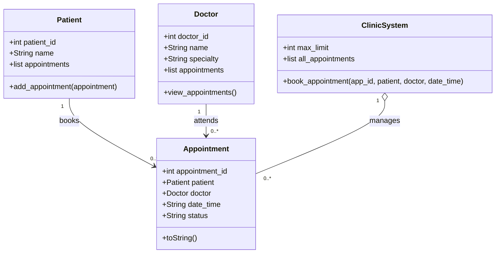

# 4. Class Diagram

## Purpose
This class diagram represents the main classes of the Clinic Appointments system and their relationships, based on the current implementation in `main.py`.

## Class Diagram

## Relationships

- **Patient — Appointment:** One patient can have zero or many appointments. Each appointment belongs to one patient.
- **Doctor — Appointment:** One doctor can have zero or many appointments. Each appointment is associated with one doctor.
- **ClinicSystem — Appointment:** The clinic system manages zero or many appointments.

## Design Notes

- `Patient`, `Doctor`, `Appointment`, and `ClinicSystem` correspond to the classes in the current `main.py` implementation.
- The maximum number of active appointments is represented by `max_limit` in `ClinicSystem`.
- The diagram reflects the current implementation. Features such as separate user accounts, detailed schedule management, and time-slot availability would require additional design and implementation.